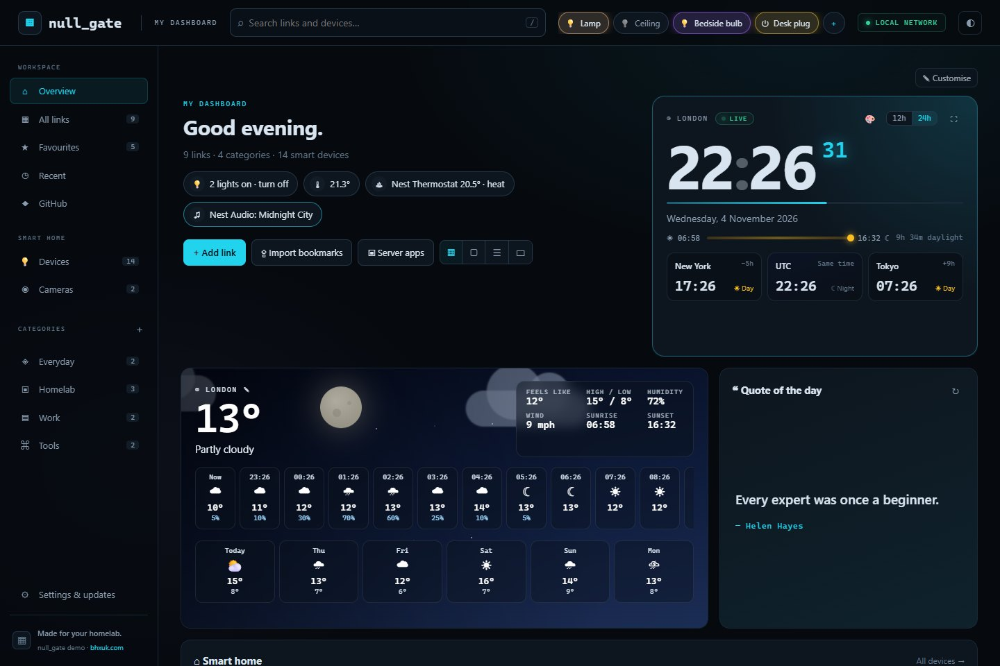
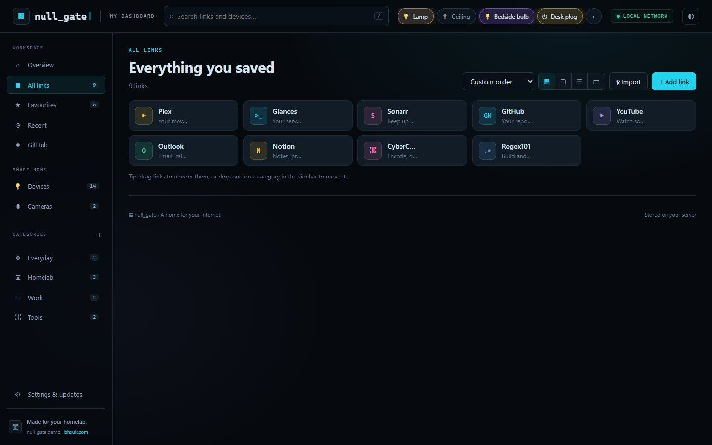
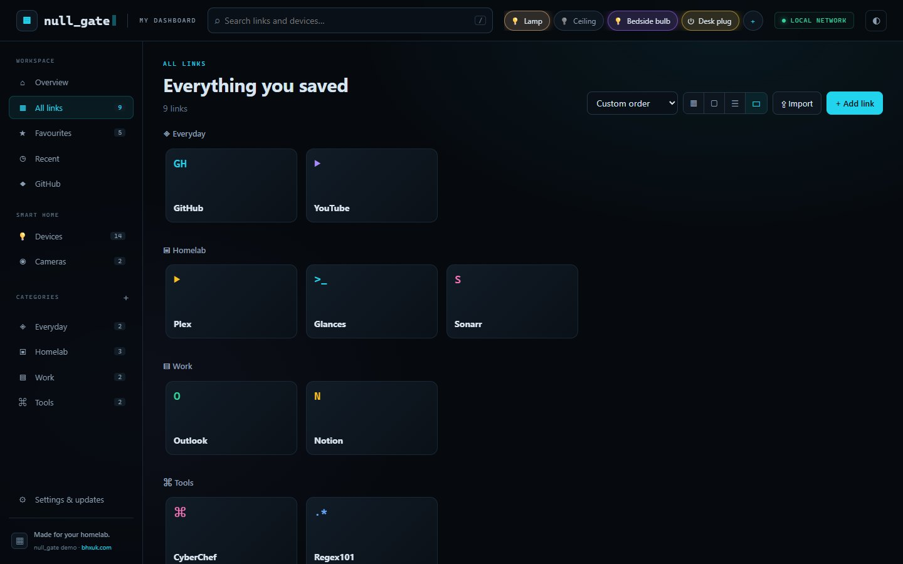
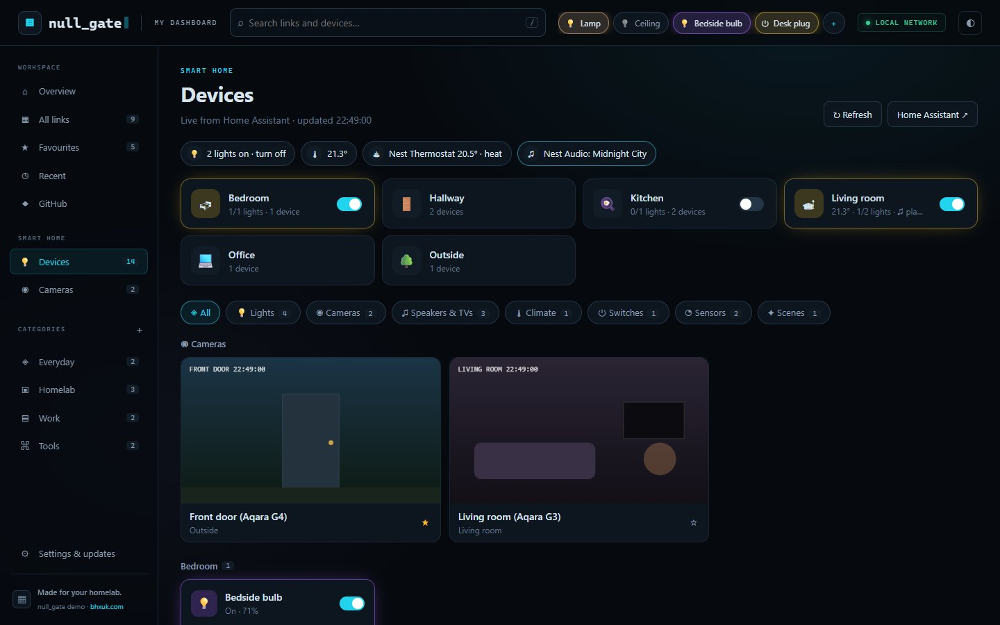
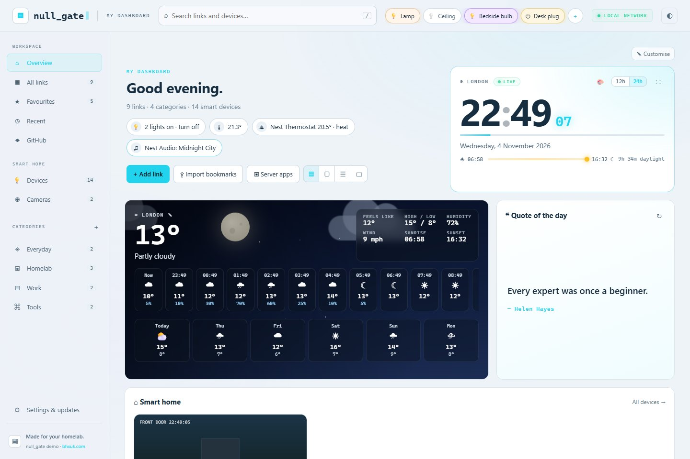
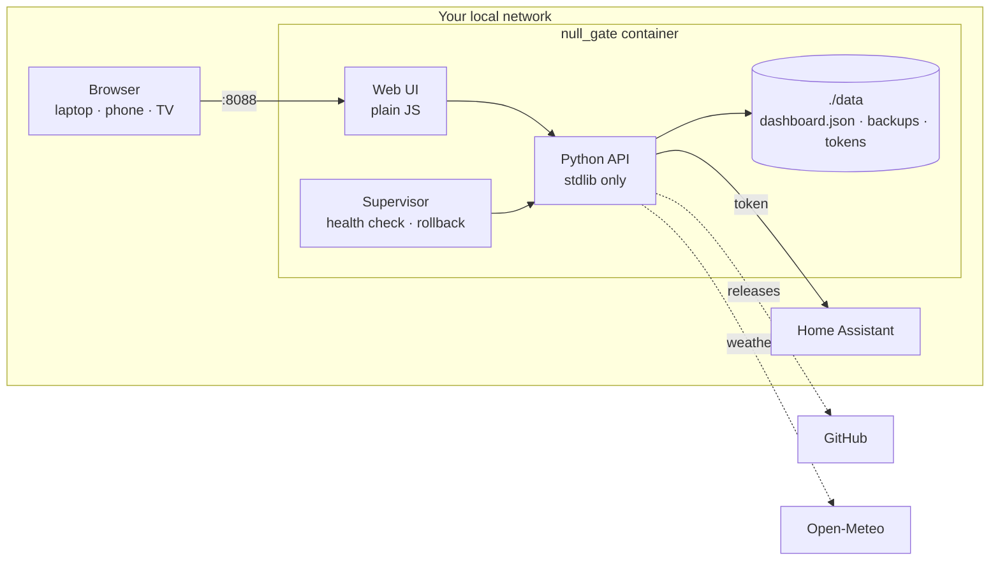

<div align="center">


# null_gate

**Your links. Your apps. Your smart home. Your everyday launchpad.**

A self-hosted dashboard for your local network. Save your favourite sites, organise your homelab,
check the time and weather, and switch the lights, all from one fast page on your own server.

[**Website**](https://bhxuk.github.io/null_gate/) · [Install](#install) · [How it works](#how-it-works) ·
[Releases](https://github.com/bhxuk/null_gate/releases) · [Changelog](CHANGELOG.md)

<sub>Designed by <a href="https://bhxuk.com">bhxuk.com</a></sub>



</div>

## Contents

- [Features](#features)
- [Screens](#screens)
- [Install](#install)
  - [Requirements](#requirements)
  - [Quick install over SSH](#quick-install-over-ssh)
  - [Manual Docker Compose setup](#manual-docker-compose-setup)
  - [First run](#first-run)
- [Smart home](#smart-home)
- [Importing links](#importing-links)
- [How it works](#how-it-works)
- [Updates](#updates)
- [Backups and recovery](#backups-and-recovery)
- [Configuration](#configuration)
- [Security](#security)
- [Troubleshooting](#troubleshooting)
- [Uninstall](#uninstall)
- [Development](#development)
- [Licence](#licence)

## Features

| Area | What you get |
|---|---|
| Overview | Tiles you can drag, resize, hide and add: greeting, clock, weather, quote, smart home, Favourites, categories and GitHub |
| Clock | Six themes (Neon, Minimal, Widget, Retro LED, Flip, Analog), 12h/24h, seconds, fullscreen, daylight bar and up to four world clocks |
| Weather | Live conditions with an animated sky, 12-hour and 6-day forecast. Uses Open-Meteo, no API key |
| Links | Add, edit, pin, categorise, search, sort and drag and drop between sections |
| Layouts | Compact cards, classic cards, table, and an Android TV-style launcher with keyboard navigation |
| Bulk import | Paste lists or import browser bookmarks, CSV/TSV, Markdown, `.url` and `.webloc` files, with a review step |
| Homelab starter | One-click shortcuts for Plex, the *arr apps, qBittorrent, Seerr, Tautulli, Home Assistant, Portainer, Glances and more |
| Smart home | Rooms, quick lights, lights, speakers, Chromecasts, thermostats, plugs, sensors, scenes and cameras through Home Assistant |
| Appearance | Dark and light themes, six accent colours, three backgrounds |
| Data | JSON on your server, export/import, snapshots, conflict detection across tabs |
| Updates | Automatic installs from GitHub releases with validation, backup and automatic rollback |

**No login. No cloud account. No Docker socket. No frontend build step. No third-party Python packages.**

## Screens

| Links | TV launcher |
|---|---|
|  |  |
| **Smart home** | **Light theme** |
|  |  |

All screenshots use sample data.

## Install

### Requirements

- A Linux server on your home network (Ubuntu, Debian, Raspberry Pi OS, Unraid, a NAS with Docker, a VM…). `amd64` and `arm64` both work.
- [Docker Engine](https://docs.docker.com/engine/install/) with the Compose v2 plugin (`docker compose version` should work).
- Git (`sudo apt install git` on Debian/Ubuntu).
- Your user in the `docker` group, or run the commands with `sudo`.

### Quick install over SSH

SSH into your server as the user who will own the install, then run:

```bash
git clone https://github.com/bhxuk/null_gate.git
cd null_gate
bash install.sh
```

The installer:

1. Checks Docker, Compose and Git are installed.
2. Creates `data/` and a `.env` file.
3. Detects your server's LAN address, your user and group IDs and your time zone.
4. Scans for ports already in use (by other services and Docker containers) and lets you pick a free one.
5. Builds the image and starts the container.
6. Prints the address to open, for example `http://192.168.1.20:4242`.

```text
  ▦  null_gate  ▌
  ─────────────────────────────────────────────
  Your links, apps and smart home in one place.
  Designed by bhxuk.com  ·  github.com/bhxuk/null_gate
  ─────────────────────────────────────────────

› Checking Docker, Compose and Git
› Creating .env
› Looking for a free port

  Port 8088 is already in use on this server. Pick a free one:

    1)  4242   the answer, twice
    2)  7777   lucky sevens
    3)  3141   pi
    4)  8484   easy to type
    5)  6060   clean and round
    6)  5050   fifty-fifty
    c)  custom port

  Choice [Enter = 4242]: 1
  Using port 4242

› Building and starting the container (the first build takes a minute)

  ✓ null_gate is running

    Open   http://192.168.1.20:4242
```

Only free ports are listed. Press Enter for the first one, type its number, type any free port, or `c` for a custom one. To skip the question, set the port up front: `NULL_GATE_PORT=8090 bash install.sh`. Run `bash install.sh` again any time to change the port; your data and settings are kept.

If the detected address is wrong (servers with several network cards), run `LAN_IP=192.168.1.50 bash install.sh`, or edit `.env` and run `docker compose up -d`.

### Manual Docker Compose setup

```bash
git clone https://github.com/bhxuk/null_gate.git
cd null_gate
mkdir -p data
cp .env.example .env
nano .env
```

In `.env` set:

- `LAN_IP` to the server's LAN address (`hostname -I` shows it).
- `PUID` and `PGID` to the output of `id -u` and `id -g`.
- `TZ` to your time zone, for example `Europe/London`.

Then start it:

```bash
docker compose up -d --build
```

Open `http://<LAN_IP>:8088`. Without a `.env` file null_gate binds to `127.0.0.1` only, so nothing on your network can reach it until you set `LAN_IP`.

The container runs as `PUID:PGID`, so the checkout and `data/` must be writable by that user. The source folder is mounted at `/app` so updates can be applied without giving the container access to Docker.

### First run

1. Choose **Add a link**, **Import bookmarks** or **Server apps**.
2. For server apps, enter the server's IP, tick the apps you run and check the ports. Ports are editable defaults, not auto-discovered.
3. Use **+** next to Categories to create, rename, re-icon, reorder or delete groups.
4. Click **✎ Customise** on the overview to move, resize, hide or add tiles.
5. Set your weather town by clicking the town name on the weather tile.
6. Press `/` to search and `n` to add a link.

## Smart home

null_gate controls devices **through Home Assistant**, so add your devices there first.

1. In Home Assistant, add your integrations (Settings → Devices & services). Google Cast, Google Nest, HomeKit Device (for Aqara), Philips Hue, TP-Link, LIFX, WiZ, Matter and hundreds more work.
2. Create a token: your profile (bottom left) → **Security** → **Long-lived access tokens** → **Create token**.
3. In null_gate open **Settings & updates → Smart home**, enter your Home Assistant address (for example `http://192.168.1.10:8123`) and paste the token. The connection is tested before it is saved.
4. Open **Smart home → Devices** or **Cameras**. Star ★ a device to pin it to the overview. Use **+** in the top bar to add quick lights.

The token is stored in `data/homeassistant.json` (readable only by the null_gate user), is never sent to the browser and is not included in exports. null_gate can only send a fixed set of actions: on/off, brightness, colour, media controls, volume, thermostat, blinds, vacuum, scenes and scripts. Locks and alarms are read-only.

## Importing links

Click **Import** (or **Import bookmarks** on the overview) and paste one link per line:

```text
Plex | http://192.168.1.20:32400/web | Media
GitHub | https://github.com | Tools
https://example.com
```

Or choose files: browser bookmark exports (HTML), `.url`, `.webloc`, `.txt`, `.csv`, `.tsv` and `.md`. CSV/TSV can use Name, URL, Category and Description headers. The review table flags invalid links and duplicates before anything is added, and a snapshot is taken first.

### links.txt

You can also keep a list in `data/links.txt` in the same `Name | URL | Category | Description` format. Start a name with `*` to pin it. These links are added when null_gate starts. Each one is added once, so if you delete it in the dashboard it stays deleted.

## How it works



- **One container, one process.** A small supervisor starts the Python web service and watches its health endpoint.
- **Your data stays in `./data`.** Links, settings and layout are in `dashboard.json`; snapshots are in `data/backups/`. The source folder never holds your data, so updates never touch it.
- **Outbound only.** null_gate calls GitHub (updates, optional repo tile) and Open-Meteo (weather). Nothing calls in.
- **Same UI everywhere.** Settings and layout are saved on the server, so every device sees the same dashboard.

## Updates

null_gate installs new releases **automatically**. It checks GitHub two minutes after starting and then every hour. To update by hand instead, untick **Settings & updates → Updates → Install updates automatically**; a banner with **Update now** appears when a release is ready.

Each update:

1. Fetches the exact release tag from `bhxuk/null_gate` and checks it is a fast-forward of your install.
2. Validates the version and runs its self-tests in a temporary Git worktree.
3. Takes a dashboard snapshot.
4. Fast-forwards the source and restarts the service.
5. Waits up to 30 seconds for the health check. If the new version fails to start, the supervisor restores the previous code and keeps your data.

Open pages reload themselves. Local source edits block automatic updates instead of being overwritten.

The supervisor and Docker base image are not changed by in-app updates. If a release note says a rebuild is needed:

```bash
cd null_gate
git pull --ff-only
docker compose up -d --build
```

A container image is also published to `ghcr.io/bhxuk/null_gate` for each release. Compose builds locally by default so the one-click updater can work.

## Backups and recovery

- **Export backup** downloads everything as JSON. **Import backup** validates a file and snapshots first.
- **Create snapshot** writes a timestamped file to `data/backups/`. Imports and updates snapshot automatically.
- To restore a snapshot, use **Import backup** with it, or stop the container, copy it to `data/dashboard.json` and start again.
- Removing the container does not delete `./data`. Back that folder up to keep your dashboard.

## Configuration

Set these in `.env`, then run `docker compose up -d`.

| Variable | Default | Purpose |
|---|---|---|
| `LAN_IP` | `127.0.0.1` | Address Docker publishes on. Set it to your server's LAN IP |
| `NULL_GATE_PORT` | `8088` | Port on the host |
| `PUID`, `PGID` | `1000` | User and group that own the checkout and `data/` |
| `TZ` | `UTC` | Container time zone |
| `NULL_GATE_HOSTNAMES` | empty | Extra local DNS names, comma-separated, e.g. `null-gate.home.arpa` |

The dashboard clock's time zone, world clocks, weather town and theme are set in the app and shared across devices.

## Security

null_gate has **no login** and is built for a trusted home network.

- It binds to your LAN address only and accepts clients from private ranges (RFC1918, loopback, link-local and IPv6 ULA).
- It checks Host and Origin on every change to block cross-site requests and DNS rebinding, and ignores forwarded IP headers.
- The container runs as a non-root user with all capabilities dropped and `no-new-privileges`. It has no Docker socket, host PID or privileged mode.
- Tokens stay in `data/` with `0600` permissions and are never sent to the browser.

Anyone who can reach null_gate can edit it and switch your devices. **Do not port-forward it or put it behind a public reverse proxy.** For access away from home, use a VPN to your network.

To report a security problem, see [SECURITY.md](SECURITY.md).

## Troubleshooting

```bash
docker compose ps
docker compose logs --tail=100 null_gate
docker compose restart null_gate
```

| Problem | Fix |
|---|---|
| Page will not open | Check `LAN_IP` in `.env` belongs to the server and your firewall allows the port (`sudo ufw allow 8088/tcp`) |
| Permission denied | Set `PUID`/`PGID` to the checkout owner and make `data/` writable, then `docker compose up -d` |
| "Host not allowed" | Use the IP or a `.local` name, or add your DNS name to `NULL_GATE_HOSTNAMES` |
| Port already in use | Run `bash install.sh` again and pick a free port from the list |
| Update refused | Run `git status`. Commit or stash local edits; `.env` and `data/` are ignored by Git |
| Dashboard data unreadable | null_gate will not reset it. Stop the container and restore a snapshot from `data/backups/` |
| Weather missing | The server needs internet access to reach `api.open-meteo.com` |

## Uninstall

```bash
cd null_gate
docker compose down
docker image rm null_gate:local
cd .. && rm -rf null_gate
```

Copy `null_gate/data/` somewhere first if you want to keep your dashboard.

## Development

```bash
python3 -m unittest discover -s tests -v
node --test tests/importer.test.mjs
DATA_DIR=./data PORT=8088 python3 -m app.main
```

- `app/` is the Python backend, `app/static/` the frontend (plain ES modules, no build), `scripts/supervisor.py` the container supervisor.
- `python3 scripts/build_preview.py` builds a browser-only preview with sample data into `preview/` (not committed). Serve it with `python3 -m http.server 8099 -d preview`.
- The website lives in `docs/` and is published to GitHub Pages by the workflow.

See [CONTRIBUTING.md](CONTRIBUTING.md) for the release process.

## Licence

[MIT](LICENSE). Designed by [bhxuk.com](https://bhxuk.com).
